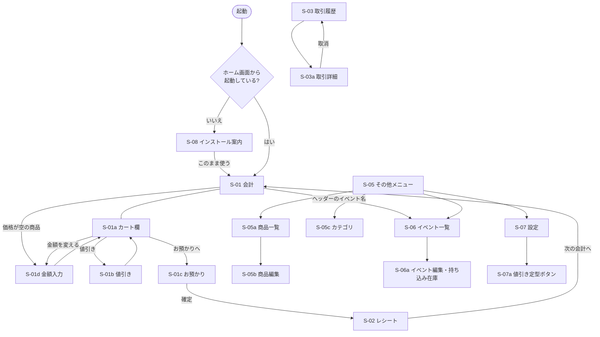

# 画面設計書：マルシェ用スマホレジ PWA

- 版：1.3
- 作成日：2026-11-05
- 状態：**確定**（2026-11-05）
- 変更履歴
  - 1.1 データ設計での決定（DD-1、DD-3）を受けて、S-05a と S-05b の「非表示」を「販売休止」と「削除」に分け、S-06a にイベントの削除を追加
  - 1.2 技術設計での決定（DT-2）を受けて、S-01 に画面を消さない動きを追加
  - 1.3 01 の v1.4 を受けて、S-05b の税率に 1% と「税込み」を追加し、S-02・S-04 に「税込み」の表示を追加。S-05b で価格を空にでき、会計のときに金額を入力・変更する S-01d を追加。S-02・S-03a に［印刷］を追加
- 前提：[01-要件定義](./01-requirements.md) v1.4

---

## 1. 共通方針

### 1.1 表示
- アプリ名は「マルシェレジ」（manifest の `name` と `short_name`）。ホーム画面のアイコンの下、インストール案内の画面などに表示する
- 縦画面専用（manifest の `orientation: portrait`）
- 基準の画面サイズは幅 375px（iPhone SE〜一般的な Android）。幅 430px 程度まで同じレイアウトで広げる
- ノッチやホームバーに重ならないよう、セーフエリア（`env(safe-area-inset-*)`）を確保する
- テーマは「ライト」と「ダーク」の 2 種類。設定画面（S-07）で選ぶ。初期値はライト
  - ライト：屋外の直射日光でも読めるよう、白い背景で高コントラストにする
  - ダーク：夜市や屋内の暗い会場向け。黒に近い背景で、まぶしさを抑える
  - スマホ本体のダークモード設定には連動しない（屋外で意図せず暗い画面にならないようにするため）
  - カテゴリの 12 色は、どちらのテーマでも文字が読める濃さにする

### 1.2 操作
- タップできる部分は 44×44px 以上。会計で使うボタンは 56px 以上
- 主要な操作ボタンは、片手の親指が届く画面下半分に置く
- 数字の入力は `inputmode="numeric"` にして、テンキーを出す
- 金額は `¥1,234` の形式で表示する
- 削除・取消・復元・全データ削除は、確認ダイアログを出してから実行する
- 保存などの完了は、画面下部に短いメッセージ（トースト）で知らせる

### 1.3 画面の構成

```
┌─────────────────────────┐
│ ヘッダー                │ 画面名、または現在のイベント
├─────────────────────────┤
│                         │
│ コンテンツ              │
│                         │
├─────────────────────────┤
│ 会計 │ 履歴 │ 集計 │その他│ 下部タブバー（タブの画面で表示）
└─────────────────────────┘
```

- 下部タブバーは「会計」「履歴」「集計」「その他」の 4 つ。出店中によく使う画面を押しやすくするため、事前準備でしか使わない画面（商品・カテゴリ・イベントの管理、設定）は「その他」にまとめる
- 全画面で開く画面（編集画面など）では、タブバーを隠して「◀ 戻る」で戻る
- 編集フォームや値引きの入力は、下から出るシート（ボトムシート）か全画面で表示する

### 1.4 共通の表示
- **更新のお知らせ**：新しいバージョンがあるときは、ヘッダーの下に「新しいバージョンがあります［更新］」と表示する。カートに商品が入っている間と、お預かり画面にいる間は表示しない
- **インストール警告**：ホーム画面から起動していない状態で「このまま使う」を選んだときは、ヘッダーの下に「ブラウザで開いています」と小さく表示し続ける

---

## 2. 画面一覧

| ID | 画面 | 表示形式 | 開き方 | 要件 |
|---|---|---|---|---|
| S-01 | 会計 | タブ | 「会計」タブ | F-05 |
| S-01a | カート欄 | S-01 の下半分（常に表示） | — | F-05 |
| S-01b | 値引き | ボトムシート | S-01a | F-05 |
| S-01c | お預かり | 全画面 | S-01a の［お預かりへ］ | F-05 |
| S-01d | 金額入力 | ボトムシート | S-01 で価格を空にした商品をタップ、S-01a のメニューの［金額を変える］ | F-02, F-05 |
| S-02 | レシート | 全画面 | 会計確定後、S-03a | F-06 |
| S-03 | 取引履歴 | タブ | 「履歴」タブ | F-07 |
| S-03a | 取引詳細 | 全画面 | S-03 の行 | F-06, F-07 |
| S-04 | 集計 | タブ | 「集計」タブ | F-08 |
| S-05 | その他メニュー | タブ | 「その他」タブ | — |
| S-05a | 商品一覧 | 全画面 | S-05 | F-02 |
| S-05b | 商品編集 | 全画面 | S-05a | F-02 |
| S-05c | カテゴリ一覧・編集 | 全画面 | S-05 | F-01 |
| S-06 | イベント一覧 | 全画面 | S-05、S-01 のヘッダー | F-03 |
| S-06a | イベント編集・持ち込み在庫 | 全画面 | S-06 | F-03, F-04 |
| S-07 | 設定 | 全画面 | S-05 | F-09, F-11 |
| S-07a | 値引き定型ボタン編集 | 全画面 | S-07 | F-05, F-11 |
| S-08 | インストール案内 | 全画面 | 起動時（ホーム画面から起動していないとき） | F-12 |

---

## 3. 画面の流れ



下部タブバーから、S-01・S-03・S-04・S-05 にはいつでも移動できる（上の図では省略）。

---

## 4. 画面詳細

### S-01 会計

画面を上下に分け、上に商品ボタン、下にカート欄（S-01a）を常に表示する。

```
┌─────────────────────────┐
│ ○○マルシェ 11/3     ▼ │ ← タップで S-06（イベント切替）
├─────────────────────────┤
│[焼き菓子][パン][雑貨][…]│ ← カテゴリタブ（横スクロール）
├─────────────────────────┤
│ ┌─────┐┌─────┐┌─────┐   │
│ │ 画像 ││ 画像 ││ 画像 │   │ ← 商品エリア（この部分だけ縦スクロール）
│ │クッキ││マフィ││スコー│   │
│ │ ¥300 ││ ¥450 ││ 売切 │   │ ← 売り切れはグレーで押せない
│ │ 残 3 ││      ││      │   │
│ └─────┘└─────┘└─────┘   │
├═════════════════════════┤
│ クッキー※ [－]2[＋] ¥600│ ← カート欄（S-01a）
│   値引き 10%       -¥60 │
│ マフィン  [－]1[＋] ¥450│
├─────────────────────────┤
│ 全体値引き        -¥100 │ ← 全体値引きがあるときだけ表示
│ 3点  合計 ¥890          │
│ [値引き] [お預かりへ ▶] │
├─────────────────────────┤
│ 会計 │ 履歴 │ 集計 │その他│
└─────────────────────────┘
```

- 商品エリアとカート欄は、それぞれ別にスクロールする
- 画面の高さの配分は、商品エリア 約 55%、カート欄 約 45% を目安にする（幅 375×高さ 667px の端末で、商品ボタンが 2 段半ほど見える）
- 商品ボタンは 3 列のグリッド（列数は固定。設定での切り替えはしない）。画像、商品名（2 行まで）、価格、残数を表示する。価格を空にした商品は、価格の代わりに「金額入力」と表示する
- 画像がない商品は、カテゴリの色で塗りつぶし、商品名の先頭の文字を大きく表示する
- 商品をタップするとカートに 1 個追加する。ボタンを一瞬光らせ、カート欄の該当行を一瞬強調する
- 価格を空にした商品をタップしたら、S-01d で金額を入力してから追加する
- 長押ししても特別な動きはしない（タップと同じく 1 個追加する）。長押しで画像の保存メニューや文字の選択が出ないようにする
- 在庫の残数を超えては追加できない（追加しようとしたらトーストで知らせる）
- 残数はカートに入れた分を差し引いて表示する
- **空の状態**
  - イベントが選ばれていない：「イベントを選んでください［イベントを選ぶ］」
  - 商品が登録されていない：「商品を登録してください［商品を登録］」
- カートにある状態でイベントを切り替えようとしたら、「カートを空にして切り替えますか？」と確認する
- S-01、S-01c、会計直後の S-02 を開いている間は、画面が自動で暗くならないようにする。ほかの画面に移ったら、スマホの設定どおりに戻す

### S-01a カート欄（S-01 の下半分）

- 1 行に「商品名、［－］数量［＋］、金額」を表示する。明細の値引きがあれば、その下に 1 行で表示する
- S-01d で金額を入力した（変えた）行は、商品名のあとに単価を小さく表示する（例：「その他 @¥500」）。同じ商品でも単価が違えば別の行にし、同じ単価なら数量を増やす。［＋］は同じ単価で 1 個増やす
- 新しく追加した商品は、カート欄の一番下に追加し、その行が見えるよう自動でスクロールする
- 数量の［－］で 0 にすると、その行を削除する
- 商品名をタップすると、その明細の操作メニュー（［金額を変える］［値引き］［削除］）を出す。［金額を変える］で S-01d、［値引き］で S-01b を開く
- 「※」は軽減税率（8%）の商品の印
- 下部の［値引き］は会計全体の値引き。S-01b を開く
- 下部に「点数」と「合計（値引き後）」を常に表示する。全体値引きがあるときは、その上に 1 行で表示する
- カートが空のときは、「商品をタップして追加」と表示し、［値引き］［お預かりへ］を押せない
- ［全クリア］はカート欄の右上に小さく置き、確認してから実行する
- カートの中身は IndexedDB に随時保存し、アプリを閉じても復元する

### S-01b 値引き（ボトムシート）

```
┌─────────────────────────┐
│ 値引き：ハーブティー ×1 │ ← 対象（明細 or 会計全体）
│ 対象金額 ¥555           │
├─────────────────────────┤
│ 定型                    │
│ [50円引き][100円引き]   │
│ [10%引き ][20%引き  ]   │
├─────────────────────────┤
│ 自由入力  [ 円 | % ]    │
│ [        15        ]    │
├─────────────────────────┤
│ 端数処理（% のときだけ） │
│ ◉ 切り捨て  -¥83 → ¥472│
│ ○ 切り上げ  -¥84 → ¥471│
│ ○ 10円単位  -¥85 → ¥470│
├─────────────────────────┤
│ [値引きを外す]  [適用]  │
└─────────────────────────┘
```

- 定型ボタンは、対象（明細 / 会計全体）で使えるものだけ表示する
- 定型ボタンをタップすると、自由入力欄にその内容が入る（すぐには適用しない）。端数処理を確認してから［適用］する
- 端数処理の欄は % のときだけ表示し、3 つの方式の値引き後金額を並べて見せる
- 初期選択は、設定の「端数処理の初期選択」に従う
- 値引き後の金額がマイナスになる値は入力できない
- すでに値引きがある対象を開いたら、今の値引きを入力済みの状態で表示する

### S-01d 金額入力（ボトムシート）

```
┌─────────────────────────┐
│ 金額：クッキー          │ ← 商品
├─────────────────────────┤
│ 登録した価格 ¥300       │ ← 金額を変えるときだけ
│ [             250 ] 円  │
├─────────────────────────┤
│ [    金額を変える    ]  │ ← 追加のときは［カートに追加］
└─────────────────────────┘
```

- 開き方は 2 つ
  - **追加**：価格を空にした商品（S-05b）をタップしたとき。入力欄は空。［カートに追加］で 1 個追加する
  - **変更**：S-01a の行のメニューで［金額を変える］を選んだとき（価格を登録した商品でもよい）。入力欄には今の単価を入れておき、全体を選んだ状態にする（打てば置き換わる）。登録した価格があれば「登録した価格 ¥300」と出す
- 開いたらすぐ入力欄にカーソルを置き、テンキーを出す
- 金額は税込・0 円以上の整数（上限 9,999,999 円）。空のときはボタンを押せない。テンキーの改行（確定）でも決定する
- 追加のとき、在庫の残りがないときは、シートを開かずにトーストで知らせる（S-01 と同じ）
- 変更したら、その行の数量は変えずに単価だけを変える。同じ商品・同じ単価の行がすでにあれば、その行に数量をまとめる（明細の値引きはまとめ先の行のものを残す）
- 登録した価格と同じ金額にしたら、元の（単価を表示しない）行に戻る
- 変えた金額はその会計だけのもので、商品に登録した価格は変わらない

### S-01c お預かり（全画面）

```
┌─────────────────────────┐
│ ◀ 戻る        お預かり │
├─────────────────────────┤
│ 合計                    │
│              ¥890       │
│ お預かり                │
│            ¥1,000       │
│ お釣り                  │
│              ¥110       │ ← 最も大きく表示する
├─────────────────────────┤
│ [＋10,000][＋5,000][＋1,000]│
│ [＋500 ][＋100 ][ぴったり]│
├─────────────────────────┤
│  [7]   [8]   [9]        │
│  [4]   [5]   [6]        │
│  [1]   [2]   [3]        │
│  [C]   [0]   [00]       │
├─────────────────────────┤
│ [       確定        ]   │ ← 不足のときは押せない
└─────────────────────────┘
```

- 金額ボタン（＋10,000／＋5,000／＋1,000／＋500／＋100）は、押すたびにお預かり額へ **足していく**（例：［＋1,000］［＋500］→ 1,500 円。［＋1,000］を 2 回 → 2,000 円）
- ［ぴったり］は、お預かり額を合計と同じ額に置き換える
- テンキーは、今の金額の右に数字を付け足す（例：0 から「1」「5」「0」「0」→ 1,500 円）
  - 金額ボタンのあとにテンキーを押すと、その金額の右に数字が付く（1,000 →「5」→ 10,005 円）。テンキーで入れ直すときは［C］を押してから入力する
- ［C］でお預かり額を 0 に戻す。押し間違えたときは［C］からやり直す
- お預かり額が合計に満たないときは、お釣り欄に「あと ¥110」と赤で表示し、［確定］を押せない
- ［確定］を押すと、取引の保存と在庫の減算を 1 トランザクションで行い、S-02 へ進む
- 確定ボタンの連打で二重に登録されないよう、処理中はボタンを押せなくする

### S-02 レシート（全画面）

```
┌─────────────────────────┐
│ お釣り  ¥110            │ ← 上部に大きく（会計直後のみ）
├─────────────────────────┤
│       ○○焼き菓子店      │
│   登録番号 T1234567890123│
│ ○○マルシェ              │
│ 2026/11/03 10:24        │
│ No. 1103-012            │
│ ─────────────────────── │
│ クッキー※ ×2      ¥600 │
│   値引き 10%       -¥60 │
│ マフィン   ×1      ¥450 │
│ 全体値引き         -¥100│
│ ─────────────────────── │
│ 合計               ¥890 │
│ (8%対象  ¥485 内税 ¥35) │
│ (10%対象 ¥405 内税 ¥36) │
│ お預かり         ¥1,000 │
│ お釣り             ¥110 │
│ ※は軽減税率対象        │
│ ─────────────────────── │
│ 連絡先：090-xxxx-xxxx   │
│ Instagram  [QR]         │
│ ありがとうございました  │
├─────────────────────────┤
│ [       印刷         ]  │
│ [     次の会計へ     ]  │
└─────────────────────────┘
```

- 会計直後は、上部にお釣りを大きく表示する。S-03a から開いたときは表示しない
- 店名以外の項目（登録番号、連絡先、SNS・URL、フッター）は、設定で空欄なら表示しない
- 「※は軽減税率対象」の注記は、8% の商品があるときだけ表示する
- 税率別の行（対象額と内税）は、取引に含まれる税率だけ出す。税率を「税込み」にした商品は、内税を計算しないので、この欄に出さない（合計には含める）
- S-01d で金額を入力した明細も、ほかの明細と同じに表示する（単価はその金額）
- 内容が画面に収まらないときは、レシート部分をスクロールする。［次の会計へ］は常に画面下に固定する
- 取り消した取引を表示するときは、レシート全体に「取消」の印を重ねて表示する
- ［印刷］でスマホの印刷機能（iPhone は AirPrint の画面）を開く。印刷するのはレシートの部分だけで、ヘッダー・お釣りの欄・ボタン・タブバーは出さない
  - テーマに関係なく、白い紙に黒い文字で印刷する。幅は 72mm まで（幅 80mm のレシート用紙に収まる。A4 などでは左上に印刷される）
  - 印刷に対応していない環境では、［印刷］を出さない

### S-03 取引履歴

```
┌─────────────────────────┐
│ 履歴  ○○マルシェ 11/3 ▼│ ← イベント選択
├─────────────────────────┤
│ 1103-012  10:24  3点 ¥890│
│ 1103-011  10:15  1点 ¥300│
│ 1103-010  10:02  2点 ¥750│
│   取消                  │ ← 取消は打ち消し線とラベル
│ …                       │
├─────────────────────────┤
│ 会計 │ 履歴 │ 集計 │その他│
└─────────────────────────┘
```

- 初期表示は現在のイベント。ヘッダーで他のイベントに切り替えられる
- 新しい順に並べる
- 行をタップすると S-03a を開く

### S-03a 取引詳細（全画面）

- S-02 と同じレシート表示に、［印刷］と［取消］ボタンを加える。［印刷］は取り消した取引でも出す（「取消」の印も印刷される）
- ［取消］は「取引 1103-012（¥890）を取り消します。在庫は戻ります。元に戻せません」と確認してから実行する
- 取り消した取引には［取消］ボタンを出さない

### S-04 集計

```
┌─────────────────────────┐
│ 集計  ○○マルシェ 11/3 ▼│ ← イベント選択（商品別は「全イベント」も可）
├─────────────────────────┤
│ [ イベント別 | 商品別 ] │
├─────────────────────────┤
│ 売上合計      ¥45,600   │
│ 取引件数      52 件     │
│ 客単価        ¥877      │
│ 値引き合計    -¥1,200   │
│ 取消          2 件      │
│ ─────────────────────── │
│ 8%  対象 ¥30,200 内税 ¥2,237│
│ 10% 対象 ¥15,400 内税 ¥1,400│
├─────────────────────────┤
│ 会計 │ 履歴 │ 集計 │その他│
└─────────────────────────┘
```

**商品別タブ**

```
│ 並べ替え [数量順|金額順]│
│ 商品        数量   金額 │
│ クッキー      40 ¥12,000│
│ マフィン      22  ¥9,900│
│ …                       │
```

- 売上は値引き後の金額で集計する。取り消した取引は含めない
- 税率別の表には、「税込み」の商品の売上を出さない（内税を計算しないため）。売上合計には含める
- 商品別では、S-01d で金額を入力した商品も 1 つの商品としてまとめる（金額ごとに分けない）
- 商品別の金額には、会計全体の値引きの按分額を反映する
- 商品別では、イベント選択に「全イベント」を加える

### S-05 その他メニュー

```
┌─────────────────────────┐
│ その他                  │
├─────────────────────────┤
│ 商品              ▶    │
│ カテゴリ          ▶    │
│ イベント・持ち込み在庫 ▶│
├─────────────────────────┤
│ 設定              ▶    │
├─────────────────────────┤
│ 会計 │ 履歴 │ 集計 │その他│
└─────────────────────────┘
```

### S-05a 商品一覧

- カテゴリごとにまとめて、並び順どおりに表示する（画像のサムネイル、商品名、価格、税率）。価格を空にした商品は「金額は会計時に入力」と表示する
- 販売中でない商品は、薄く表示して「販売休止」と付ける
- 削除した商品は表示しない
- ［＋ 商品を追加］で S-05b を新規作成モードで開く
- ［並べ替え］モードでは、各行の［↑］［↓］で順番を変える（ドラッグ操作は使わない）

### S-05b 商品編集

```
┌─────────────────────────┐
│ ◀ 戻る    商品編集 [保存]│
├─────────────────────────┤
│ ┌───────┐               │
│ │ 画像  │ [撮影][選択]  │
│ └───────┘ [削除]        │
│ 商品名  [クッキー     ] │
│ 価格(税込)[ 300 ] 円    │
│ 税率 [1%|8%|10%|税込み] │
│ カテゴリ [焼き菓子  ▼] │
│ 在庫を管理する   [ON ]  │
│ 販売中           [ON ]  │
├─────────────────────────┤
│ [ この商品を削除する ]  │
└─────────────────────────┘
```

- 商品名は必須。価格は 0 円以上の整数で、空にしてもよい。空にすると、会計のときに金額を入力する（S-01d）。入力欄の下に「空にすると、会計のときに金額を入力します」と出す
- 税率の初期値は、同じカテゴリの直前に登録した商品に合わせる（最初は 8%）
- 画像は選んだときに縮小・圧縮し、プレビューを表示する
- 入力途中で［戻る］を押したら、「変更を破棄しますか？」と確認する
- ［この商品を削除する］は、「商品一覧から消えます。過去の取引の記録は残ります」と確認してから実行する。新規作成のときは表示しない
- 削除した商品がカートに入っていたら、カートから外す

### S-05c カテゴリ一覧・編集

- 一覧：カテゴリ名、色、商品数。［↑］［↓］で並べ替える
- 追加・編集はボトムシート：名前と、色（12 色のパレットから選ぶ）
- 商品が属しているカテゴリを削除しようとしたら、「先に商品を別のカテゴリへ移してください」と表示する

### S-06 イベント一覧

- 開催日の新しい順に表示する。現在のイベントには「現在」のラベルを付ける
- 行をタップすると、「現在のイベントにする」「編集」を選ぶメニューを出す
- ［＋ イベントを追加］で S-06a を新規作成モードで開く

### S-06a イベント編集・持ち込み在庫

```
┌─────────────────────────┐
│ ◀ 戻る  イベント編集[保存]│
├─────────────────────────┤
│ イベント名 [○○マルシェ] │
│ 開催日     [2026/11/03] │
│ 場所       [         ]  │
│ メモ       [         ]  │
├─────────────────────────┤
│ 持ち込み在庫            │
│ 商品     持込  販売  残 │
│ クッキー [－]20[＋] 15 5│
│ マフィン [－]10[＋] 10 0│
│ …                       │
├─────────────────────────┤
│ [現在のイベントにする]  │
│ [このイベントを削除する]│ ← 会計したことがないときだけ
└─────────────────────────┘
```

- 持ち込み在庫の一覧には、「在庫を管理する」が ON の販売中の商品だけを並べる
- 持ち込み数は［－］［＋］のほか、数字をタップして直接入力できる
- 持ち込み数は販売数より少なくできない
- 会期中でも編集でき、補充したときは持ち込み数を増やす
- ［このイベントを削除する］は、取引が 1 件もない（取り消した取引もない）イベントで、新規作成でないときだけ表示する。「イベント「○○マルシェ」を削除します。元に戻せません」と確認してから実行する
- 現在のイベントを削除したら、現在のイベントは「未選択」になる

### S-07 設定

```
┌─────────────────────────┐
│ ◀ 戻る           設定  │
├─────────────────────────┤
│ ■ レシート              │
│ 店名        [         ] │
│ 登録番号    [T        ] │
│ 連絡先      [         ] │
│ SNS・URL 1  [ラベル][URL]│
│ SNS・URL 2  [ラベル][URL]│
│ SNS・URL 3  [ラベル][URL]│
│ フッター    [         ] │
│ [レシートのプレビュー]  │
├─────────────────────────┤
│ ■ 値引き                │
│ 端数処理の初期選択 [切り捨て▼]│
│ 定型ボタン        ▶    │ → S-07a
├─────────────────────────┤
│ ■ データ                │
│ CSV 書き出し      ▶    │ → イベント選択（全イベントも可）→ 保存
│ バックアップ（JSON）▶  │
│ 復元（JSON）      ▶    │
│ 前回のバックアップ 11/3 18:20│
│ データの保護  有効 ✓   │ ← persist() の状態。無効なら［有効にする］
│ ⚠ アイコンを削除すると │
│   データも消えます      │
│ [全データを削除]        │
├─────────────────────────┤
│ ■ 表示                  │
│ テーマ  [ライト|ダーク] │
├─────────────────────────┤
│ ■ アプリ                │
│ バージョン 1.0.0        │
└─────────────────────────┘
```

- 入力欄は、入力し終えたとき（フォーカスが外れたとき）に自動で保存する
- 登録番号は「T＋13 桁」でなければ、入力欄の下にエラーを表示する
- **復元**：ファイルを選ぶ → 中身の概要（商品数、イベント数、取引数、バックアップした日時）を表示 →「今のデータはすべて置き換わります」と確認 → 実行
- **全データを削除**：確認ダイアログで「削除」と入力させてから実行する

### S-07a 値引き定型ボタン編集

- 一覧：表示名、種類と値、使える対象。［↑］［↓］で並べ替える
- 追加・編集はボトムシート：表示名、種類（円 / %）、値、使える対象（商品ごと / 会計全体 / 両方）
- 8 件登録したら［＋ 追加］を押せなくする

### S-08 インストール案内（全画面）

```
┌─────────────────────────┐
│   マルシェレジ          │
│                         │
│ ホーム画面に追加して    │
│ 使ってください          │
│                         │
│ ① 画面下の [共有] を    │  ← iPhone の場合
│    タップ               │
│ ② 「ホーム画面に追加」  │
│    を選ぶ               │
│ ③ ホーム画面のアイコン  │
│    から起動             │
│   （手順の図）          │
│                         │
│ ⚠ ブラウザで開いたまま │
│ 使うと、追加したアプリと│
│ データが別になります    │
│                         │
│      [このまま使う]     │  ← 小さめに表示
└─────────────────────────┘
```

- Android で `beforeinstallprompt` が使えるときは、手順の代わりに［インストール］ボタンを大きく表示する
- ［このまま使う］を選ぶと S-01 へ進み、そのブラウザでは次回からこの画面を出さない

---

## 5. 確認事項と決定内容

| # | 内容 | 決定内容 |
|---|---|---|
| D-1 | 下部タブバーの構成 | **決定**：会計 / 履歴 / 集計 / その他 の 4 つ。管理と設定は「その他」にまとめる |
| D-2 | 会計画面の商品ボタンの列数 | **決定**：3 列で固定 |
| D-3 | お預かりのクイックボタンの動き | **決定**：押すたびに足していく。＋10,000／＋5,000／＋1,000／＋500／＋100 と［ぴったり］を用意する |
| D-4 | カートの表示方法 | **決定**：会計画面を上下に分け、下半分にカートの中身を常に表示する |
| D-5 | 商品ボタンを長押ししたときの動作 | **決定**：特別な動きはしない（タップと同じく 1 個追加） |
| D-6 | テーマ | **決定**：ライト / ダークを設定画面で選ぶ。初期値はライト。スマホ本体の設定には連動しない |
| D-7 | アプリ名（ホーム画面のアイコンの下に出る名前） | **決定**：「マルシェレジ」 |
