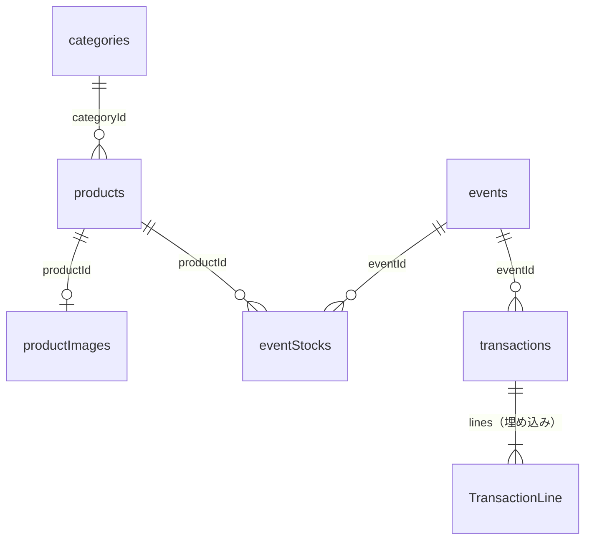

# データ設計書：マルシェ用スマホレジ PWA

- 版：1.1
- 作成日：2026-11-06
- 状態：**確定**（2026-11-06）
- 変更履歴
  - 1.1 M2 の実装に合わせて、商品画像を Blob ではなく ArrayBuffer（と形式 `type`）で保存するように変更（iPhone などの WebKit では、プライベートブラウズなどで Blob を保存できないことがあるため）
- 前提：[01-要件定義](./01-requirements.md) v1.2、[02-画面設計](./02-screen-design.md) v1.1

---

## 1. 方針

| 項目 | 方針 | 理由 |
|---|---|---|
| 保存先 | IndexedDB（Dexie.js 経由）。データベース名は `marche-register` | 要件定義 9 章 |
| ID | 文字列の UUID（`crypto.randomUUID()`） | バックアップから戻したときに番号がぶつからない |
| 金額 | 円単位の整数（`number`）。小数は持たない | 要件定義 6.1 |
| 日時 | 取引日時などの「時刻」はミリ秒の数値（`Date.now()`）。イベントの開催日は `YYYY-MM-DD` の文字列 | 開催日は時差の影響を受けないよう、日付だけの文字列にする |
| 過去の記録 | 取引には、会計時点の商品名・単価・税率・カテゴリ名をコピーして保存する（スナップショット） | 要件定義 6.4。あとで商品を編集・削除しても、過去の取引と集計は変わらない |
| 計算で出せる値 | 在庫の「販売数」「残り」は保存せず、取引から毎回計算する | 保存した数と取引の中身が食い違うことがなくなる。1 イベント数百件なら計算は一瞬で終わる |
| 取引の削除 | しない。取消は「取消済み」の印を付けるだけ | 要件定義 F-07 |

---

## 2. ストア（テーブル）一覧



| ストア | 内容 | 主キー | インデックス |
|---|---|---|---|
| `categories` | カテゴリ | `id` | `sortOrder` |
| `products` | 商品 | `id` | `categoryId`、`sortOrder` |
| `productImages` | 商品画像（ArrayBuffer） | `productId` | — |
| `events` | イベント | `id` | `date` |
| `eventStocks` | イベントごとの持ち込み数 | `[eventId+productId]` | `eventId` |
| `transactions` | 取引（明細を埋め込む） | `id` | `eventId`、`[eventId+seq]`、`createdAt` |
| `kv` | 設定・カート・現在のイベントなど、1 件ずつの値 | `key` | — |

Dexie のスキーマ定義（バージョン 1）：

```ts
db.version(1).stores({
  categories: 'id, sortOrder',
  products: 'id, categoryId, sortOrder',
  productImages: 'productId',
  events: 'id, date',
  eventStocks: '[eventId+productId], eventId',
  transactions: 'id, eventId, [eventId+seq], createdAt',
  kv: 'key',
});
```

- 画像を `products` と別のストアにするのは、商品の一覧や集計で画像を読み込まずに済むようにするため
- 値引きの定型ボタンは最大 8 件と少ないので、ストアを分けず設定（`kv` の `settings`）の中に配列で持つ

---

## 3. 型定義

### 3.1 共通

```ts
type Id = string;            // UUID
type Yen = number;           // 円単位の整数
type EpochMs = number;       // Date.now() の値
type DateString = string;    // 'YYYY-MM-DD'
type TaxRate = 0 | 1 | 8 | 10;   // 0 は「税込み」（内消費税を計算しない）
type Rounding = 'floor' | 'ceil' | 'round10';  // 切り捨て / 切り上げ / 10 円単位
type CategoryColor =
  | 'c1' | 'c2' | 'c3' | 'c4' | 'c5' | 'c6'
  | 'c7' | 'c8' | 'c9' | 'c10' | 'c11' | 'c12';
```

- カテゴリの色は色コードではなく `c1`〜`c12` の記号で持つ。実際の色はテーマ（ライト / ダーク）ごとに CSS で決める（画面設計 1.1）

### 3.2 カテゴリ（`categories`）

```ts
interface Category {
  id: Id;
  name: string;           // 1〜20 文字
  color: CategoryColor;
  sortOrder: number;      // 小さいほど左
  createdAt: EpochMs;
  updatedAt: EpochMs;
}
```

### 3.3 商品（`products`）

```ts
interface Product {
  id: Id;
  name: string;           // 1〜40 文字
  price: Yen;             // 税込。0 以上
  taxRate: TaxRate;
  categoryId: Id;
  hasImage: boolean;      // productImages にあるか（画像を読まずに判定するため）
  tracksStock: boolean;   // 在庫を管理する
  isOnSale: boolean;      // 販売中（OFF なら会計画面に出さない）
  deletedAt: EpochMs | null;  // 削除（論理削除）した日時。null 以外なら商品一覧にも出さない
  sortOrder: number;      // カテゴリ内の並び順
  createdAt: EpochMs;
  updatedAt: EpochMs;
}
```

### 3.4 商品画像（`productImages`）

```ts
interface ProductImage {
  productId: Id;
  data: ArrayBuffer;      // 長辺 400px、JPEG（要件定義 6.6）
  type: string;           // 'image/jpeg'
  width: number;
  height: number;
}
```

### 3.5 イベント（`events`）

```ts
interface MarketEvent {
  id: Id;
  name: string;           // 1〜40 文字
  date: DateString;       // 開催日
  location: string;       // 空文字可
  memo: string;           // 空文字可
  nextSeq: number;        // 次に使う取引の連番（1 から）
  createdAt: EpochMs;
  updatedAt: EpochMs;
}
```

- `nextSeq` は会計の確定と同じトランザクションで 1 増やす。取り消しても戻さないので、欠番は使い回されない（要件定義 6.5）

### 3.6 持ち込み在庫（`eventStocks`）

```ts
interface EventStock {
  eventId: Id;
  productId: Id;
  broughtQty: number;     // 持ち込み数。0 以上の整数
  updatedAt: EpochMs;
}
```

- 販売数と残りは保存せず、次のように計算する
  - 販売数 ＝ そのイベントの **有効な** 取引の明細のうち、その商品の数量の合計
  - 残り ＝ 持ち込み数 − 販売数
- 在庫を管理する商品で、`eventStocks` に行がない場合は、持ち込み数 0（＝売り切れ）として扱う

### 3.7 取引（`transactions`）

```ts
interface Transaction {
  id: Id;
  eventId: Id;
  seq: number;                 // イベント内の連番
  receiptNo: string;           // 'MMDD-NNN'（作成時に決めて保存する）
  createdAt: EpochMs;          // 取引日時
  status: 'valid' | 'voided';  // 有効 / 取消
  voidedAt: EpochMs | null;

  // 会計時点のコピー（スナップショット）
  eventName: string;
  eventDate: DateString;
  receipt: ReceiptSnapshot;    // レシートに出す店の情報

  lines: TransactionLine[];
  orderDiscount: Discount | null;   // 会計全体の値引き

  subtotal: Yen;               // 明細値引き後の合計（全体値引きの前）
  orderDiscountAmount: Yen;    // 全体値引きの額（なければ 0）
  total: Yen;                  // 支払う合計
  taxes: TaxSummary[];         // 税率別（取引に含まれる税率だけ）
  tendered: Yen;               // お預かり
  change: Yen;                 // お釣り
}

interface TransactionLine {
  lineNo: number;              // 1 から
  productId: Id;
  productName: string;         // ↓ 会計時点のコピー
  categoryName: string;
  unitPrice: Yen;
  taxRate: TaxRate;
  qty: number;                 // 1 以上の整数
  grossAmount: Yen;            // 単価 × 数量
  lineDiscount: Discount | null;
  lineDiscountAmount: Yen;     // 明細値引きの額（なければ 0）
  orderDiscountShare: Yen;     // 全体値引きの按分額（なければ 0）
  netAmount: Yen;              // grossAmount − lineDiscountAmount − orderDiscountShare
}

type Discount =
  | { kind: 'yen'; value: Yen }                                  // 例：100 円引き
  | { kind: 'percent'; value: number; rounding: Rounding };     // 例：10% 引き（1〜100 の整数）

interface ReceiptSnapshot {    // 会計した時点の設定（Settings）のコピー
  shopName: string;
  invoiceNo: string;
  contact: string;
  links: { label: string; url: string }[];
  footer: string;
}

interface TaxSummary {
  rate: TaxRate;
  taxableAmount: Yen;          // 税率別の税込合計（値引き後）
  taxAmount: Yen;              // 内消費税
}
```

- 「イベント名」「開催日」もコピーする。あとでイベント名を直しても、過去のレシートや CSV は変わらない
- 店名・登録番号・連絡先・SNS・URL・フッターもコピーする（`receipt`）。あとで設定を変えても、過去のレシートは会計したときの内容で表示する。お客さんに渡したものと同じ内容をいつでも出せ、インボイスの控えとしても正確になる（1 件あたり数百文字増える程度）
- `receiptNo` は作成時に決めて保存する。あとで開催日を直しても、番号は変わらない
- 計算結果（`netAmount` や `taxes` など）も保存する。集計や CSV は保存した値を足すだけにし、計算のしかたを将来変えても過去の数字が変わらないようにする

### 3.8 設定など（`kv`）

`kv` には、次のキーで 1 件ずつ保存する。

| key | 型 | 内容 |
|---|---|---|
| `settings` | `Settings` | 設定画面（S-07）の内容 |
| `currentEventId` | `Id \| null` | 現在のイベント |
| `cart` | `Cart` | 会計中のカート（アプリを閉じても復元するため） |
| `lastBackupAt` | `EpochMs \| null` | 前回 JSON バックアップした日時 |
| `installWarningDismissed` | `boolean` | インストール案内で「このまま使う」を選んだか |

```ts
interface Settings {
  shopName: string;
  invoiceNo: string;            // '' または 'T' + 13 桁
  contact: string;              // 複数行可
  links: { label: string; url: string }[];  // 最大 3 件
  footer: string;
  defaultRounding: Rounding;    // 初期値 'floor'
  theme: 'light' | 'dark';      // 初期値 'light'
  discountPresets: DiscountPreset[];  // 最大 8 件。配列の順がボタンの順
}

interface DiscountPreset {
  id: Id;
  label: string;                // 例：'100円引き'
  kind: 'yen' | 'percent';
  value: number;
  scope: 'line' | 'order' | 'both';  // 商品ごと / 会計全体 / 両方
}

interface Cart {
  eventId: Id;
  lines: { productId: Id; qty: number; discount: Discount | null }[];
  orderDiscount: Discount | null;
  updatedAt: EpochMs;
}
```

- カートには商品の ID と数量だけを持つ。商品名や価格は、確定するときに商品データから読み、取引にコピーする
- `settings` の初期値（初めて起動したとき）
  - 店名などのレシート項目：空
  - `defaultRounding`：`'floor'`、`theme`：`'light'`
  - `discountPresets`：「50円引き」「100円引き」「10%引き」「20%引き」（すべて `scope: 'both'`）

---

## 4. 計算のルール（実装の基準）

要件定義 6 章を、計算できる手順に落としたもの。テストはこの章の例で作る。

### 4.1 % 値引きの額

`base`（対象金額）と `p`（%）から、値引き額を次のように出す。整数のかけ算・割り算で計算し、小数の誤差を出さない。

| 方式 | 値引き額 | 例：555 円の 15% 引き |
|---|---|---|
| `floor` 切り捨て | `floor(base × p ÷ 100)` | 83 円引き → 472 円 |
| `ceil` 切り上げ | `ceil(base × p ÷ 100)` | 84 円引き → 471 円 |
| `round10` 10 円単位 | `base − floor(base × (100 − p) ÷ 1000) × 10` | 85 円引き → 470 円 |

- 円指定の値引きは、その額をそのまま使う。ただし対象金額を超えない
- `p` は 1〜100 の整数

### 4.2 1 取引の計算手順

1. 明細ごとに `grossAmount ＝ 単価 × 数量`
2. 明細値引きを引く：`afterLine ＝ grossAmount − lineDiscountAmount`
3. `subtotal ＝ afterLine の合計`
4. 全体値引きの額を出す（対象は `subtotal`）
5. **税率ごとに按分する**：税率別の `afterLine` 合計の比率で分け、1 円未満は切り捨てる。余った 1 円は、合計の大きい税率に足す（同じ額なら 10% に足す）
6. **税率の中で明細ごとに按分する**：その税率の按分額を、明細の `afterLine` の比率で分け、1 円未満は切り捨てる。余りは `afterLine` の大きい明細から順に 1 円ずつ足す（同じ額なら行番号の小さい明細から）
7. `netAmount ＝ afterLine − orderDiscountShare`
8. 税率ごとに `taxableAmount ＝ netAmount の合計`、`taxAmount ＝ floor(taxableAmount × 税率 ÷ (100 + 税率))`。「税込み」（0）は 5〜7 の按分には加えるが、`taxes` には入れない
9. `total ＝ subtotal − orderDiscountAmount`（＝ すべての `netAmount` の合計）

手順 6 は、商品別の集計と CSV で「全体値引きを商品ごとにいくら引いたか」を出すために必要になる。

### 4.3 計算例（画面設計 S-02 のレシート）

| 明細 | 税率 | grossAmount | 明細値引き | afterLine | 全体値引きの按分 | netAmount |
|---|---|---|---|---|---|---|
| クッキー ×2 | 8% | 600 | 10%（切り捨て）→ 60 | 540 | 55 | 485 |
| マフィン ×1 | 10% | 450 | — | 450 | 45 | 405 |

- `subtotal` ＝ 990、全体値引き 100 円
- 税率への按分：8% は `floor(100 × 540 ÷ 990)` ＝ 54、10% は `floor(100 × 450 ÷ 990)` ＝ 45。余りの 1 円は合計の大きい 8% に足して 55
- 8%：対象 485 円、内税 `floor(485 × 8 ÷ 108)` ＝ 35 円
- 10%：対象 405 円、内税 `floor(405 × 10 ÷ 110)` ＝ 36 円
- 合計 890 円

### 4.4 集計

| 項目 | 計算 |
|---|---|
| 売上合計 | 有効な取引の `total` の合計 |
| 取引件数 | 有効な取引の件数 |
| 客単価 | 売上合計 ÷ 取引件数（1 円未満は四捨五入。0 件なら表示しない） |
| 値引き合計 | 有効な取引の `lineDiscountAmount` と `orderDiscountAmount` の合計 |
| 税率別 | 有効な取引の `taxes` を税率ごとに合計する（内税は取引ごとに出した額の合計で、合計額から計算し直さない） |
| 取消件数 | `status = 'voided'` の件数 |
| 商品別の数量・金額 | 有効な取引の明細を `productId` ごとに合計（数量は `qty`、金額は `netAmount`）。商品名は最新の明細の `productName` を使う |

---

## 5. 主な処理とトランザクション

| 処理 | 読み書きするストア | 内容 |
|---|---|---|
| 会計の確定 | `events`、`eventStocks`、`transactions`、`products`、`categories`、`kv` | ① 在庫の残りを計算し、足りるか確かめる ② `nextSeq` から取引番号を作り、`nextSeq` を 1 増やす ③ 取引を保存 ④ カートを空にする。①〜④ を 1 つのトランザクションで行い、途中で失敗したらすべて元に戻る |
| 取引の取消 | `transactions` | `status` を `'voided'`、`voidedAt` を今の時刻にする。在庫は取引から計算しているので、これだけで戻る |
| 持ち込み数の変更 | `eventStocks`、`transactions` | 販売数より少なくしようとしたら保存しない |
| 商品の削除 | `products`、`productImages`、`kv` | `deletedAt` を入れる。画像は残す。カートに入っていたら外す |
| カテゴリの削除 | `categories`、`products` | 削除していない商品が 1 つでもあれば削除しない |
| イベントの削除 | `events`、`eventStocks`、`transactions`、`kv` | そのイベントの取引が 1 件でもあれば（取消済みを含む）削除しない。削除するときは、そのイベントの持ち込み在庫も消す。現在のイベントだったら `currentEventId` を `null` にする。カートがそのイベントのものなら空にする |
| 全データの削除 | すべて | すべてのストアを空にし、設定を初期値に戻す |

---

## 6. データ移行（バージョンアップ）

- ストアやインデックスを変えるときは、Dexie の `db.version(n)` を 1 つ上げ、必要なら `.upgrade()` で古いデータを書き換える
- 項目を増やすときは、古いデータに値がなくても動くように、読み込むときに初期値を補う
- 移行の処理は、前のバージョンのデータを使ったテストを用意してから追加する
- アプリの更新で移行が走る前に、JSON バックアップを取るよう案内する画面は作らない（更新は小さく、こまめに行う前提）

---

## 7. JSON バックアップの形式

```json
{
  "format": "marche-register-backup",
  "formatVersion": 1,
  "appVersion": "1.0.0",
  "exportedAt": "2026-11-03T18:20:00+09:00",
  "counts": { "categories": 4, "products": 32, "events": 5, "transactions": 412 },
  "data": {
    "categories": [ ... ],
    "products": [ ... ],
    "productImages": [ { "productId": "...", "mime": "image/jpeg", "width": 400, "height": 300, "base64": "..." } ],
    "events": [ ... ],
    "eventStocks": [ ... ],
    "transactions": [ ... ],
    "settings": { ... },
    "currentEventId": "..."
  }
}
```

- ファイル名：`marche-register-backup-YYYYMMDD-HHmm.json`
- 画像は ArrayBuffer のままでは JSON にできないので、Base64 の文字列にする（50 枚で約 3.4MB）
- カートと `installWarningDismissed` は含めない（その端末だけの一時的な状態のため）
- 書き出したら `lastBackupAt` を更新する
- **復元のチェック**
  - `format` が違う、または JSON として読めない →「このアプリのバックアップファイルではありません」
  - `formatVersion` が今のアプリより新しい →「アプリを最新にしてから復元してください」
  - `formatVersion` が古い → 読み込むときに今の形式へ変換する
  - 問題なければ、`counts` と `exportedAt` を確認画面に表示する（画面設計 S-07）
- 復元は 1 つのトランザクションで「全ストアを空にする → 書き込む」を行う。途中で失敗したら元のデータのまま残る

---

## 8. CSV の形式

- 文字コード：UTF-8（BOM 付き）。改行：CRLF
- 1 行 ＝ 1 明細。取り消した取引の明細も出力し、「状態」列で見分ける
- ファイル名：`marche-register-<イベント名>-<開催日 YYYYMMDD>.csv`。全イベントのときは `marche-register-all-<書き出した日 YYYYMMDD>.csv`
- 並び順：開催日 → 取引番号の連番 → 明細番号

| # | 列名 | 例 | 元のデータ |
|---|---|---|---|
| 1 | イベント名 | ○○マルシェ | `eventName` |
| 2 | 開催日 | 2026/11/03 | `eventDate` |
| 3 | 取引番号 | 1103-012 | `receiptNo` |
| 4 | 取引日時 | 2026/11/03 10:24:05 | `createdAt` |
| 5 | 状態 | 有効 / 取消 | `status` |
| 6 | 明細番号 | 1 | `lineNo` |
| 7 | 商品名 | クッキー | `productName` |
| 8 | カテゴリ | 焼き菓子 | `categoryName` |
| 9 | 税率 | 8%（「税込み」は 税込み） | `taxRate` |
| 10 | 単価 | 300 | `unitPrice` |
| 11 | 数量 | 2 | `qty` |
| 12 | 小計 | 600 | `grossAmount` |
| 13 | 明細値引き | 60 | `lineDiscountAmount` |
| 14 | 全体値引き按分 | 55 | `orderDiscountShare` |
| 15 | 値引き後金額 | 485 | `netAmount` |

- 金額は「,」や「¥」を付けず、数字だけにする（Excel で計算できるように）
- 値に「,」「"」、改行が入るときは `"` で囲む
- 先頭が `=` `+` `-` `@` の文字列（商品名など）は、先頭に `'` を付ける（Excel で数式として動かないようにするため）
- お預かり・お釣り・取引の合計は出さない。明細ごとの行に取引全体の値を入れると、Excel で合計したときに重複して数えてしまうため

---

## 9. 容量の見積もり

| データ | 1 件あたり | 想定件数 | 合計 |
|---|---|---|---|
| 商品画像 | 約 50KB | 50 | 約 2.5MB |
| 取引 | 約 1KB（明細 3 行程度） | 100 件 × 50 イベント | 約 5MB |
| その他 | — | — | 1MB 未満 |

合計 10MB 程度。iPhone・Android とも、ブラウザの保存容量の上限には十分余裕がある。

---

## 10. 確認事項と決定内容

| # | 内容 | 決定内容 |
|---|---|---|
| DD-1 | 商品の「販売中 OFF」と「非表示にする（削除）」を同じものとするか、別にするか | **決定**：別にする。販売中 OFF は会計画面にだけ出さない（一覧には「販売休止」と表示）。削除は一覧からも消す。ボタン名は「この商品を削除する」に変更（01 v1.2、02 v1.1 に反映） |
| DD-2 | レシートの店名・登録番号などをあとで変えたとき、過去のレシートの表示を変えるか | **決定**：変えない。会計したときの内容を取引にコピーして保存し、その内容で表示する |
| DD-3 | イベントを削除できるようにするか | **決定**：会計したことのないイベント（取消済みの取引もないもの）だけ削除できる。S-06a に［このイベントを削除する］を追加（01 v1.2、02 v1.1 に反映） |
