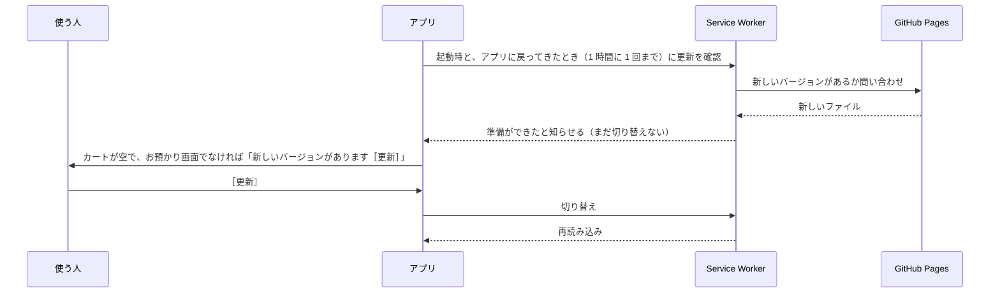

# 技術設計書：マルシェ用スマホレジ PWA

- 版：1.1
- 作成日：2026-11-06
- 状態：**確定**（2026-11-06）
- 変更履歴
  - 1.1 M1 の実装に合わせて、型定義の置き場所を `db/types.ts` から `domain/types.ts` に変更（domain が db に依存しないようにするため）。`domain/errors.ts` を追加
- 前提：[01-要件定義](./01-requirements.md) v1.3、[02-画面設計](./02-screen-design.md) v1.2、[03-データ設計](./03-data-design.md) v1.0

---

## 1. 使うもの

### 1.1 ライブラリ

| 用途 | ライブラリ | 選んだ理由 |
|---|---|---|
| 言語 | TypeScript（`strict`） | 要件定義 9 章 |
| UI | React | 要件定義 9 章 |
| ビルド | Vite ＋ `@vitejs/plugin-react` | 要件定義 9 章 |
| 画面の切り替え | React Router（ハッシュ方式） | Android の戻るボタンで前の画面に戻れる。GitHub Pages ではハッシュ方式（`#/history`）なら追加の設定がいらない |
| データベース | Dexie.js ＋ `dexie-react-hooks` | 要件定義 9 章。`useLiveQuery` で、保存したデータが画面に自動で反映される |
| カートの状態 | Zustand | タップしてからの反映を速くするため、カートだけはメモリに持つ（4 章） |
| PWA | vite-plugin-pwa（Workbox） | 要件定義 9 章 |
| QR コード | `qrcode` | 端末内で SVG を作れるので、オフラインでも表示できる |
| バックアップの検査 | Zod | 復元するファイルの中身が正しい形か、まとめて確かめられる |

- 日付の表示はライブラリを使わず、`Intl.DateTimeFormat` で行う
- 文字はスマホに入っているフォント（system-ui）を使う。Web フォントは読み込まない
- それぞれ、実装を始める時点の最新の安定版を使い、`package-lock.json` で固定する

### 1.2 開発用のツール

| 用途 | ツール |
|---|---|
| パッケージ管理 | npm |
| 単体テスト | Vitest ＋ fake-indexeddb ＋ Testing Library（jsdom） |
| 画面を通したテスト（E2E） | Playwright（iPhone と Android の画面サイズを再現。エンジンは WebKit と Chromium） |
| 書き方のチェック | ESLint（typescript-eslint、react-hooks）、Prettier |
| 公開 | GitHub Actions → GitHub Pages |

---

## 2. ディレクトリ構成

```
/
├─ index.html
├─ vite.config.ts
├─ public/                 アイコン、インストール案内の図
├─ src/
│  ├─ main.tsx             起動処理（beforeinstallprompt の受け取りもここ）
│  ├─ app/                 App、ルーティング、エラー時の画面、共通の枠（ヘッダー・タブバー）
│  ├─ domain/              計算と変換（React も Dexie も使わない純粋な関数）
│  │   ├─ types.ts         型定義（03 の 3 章）。db からも使う
│  │   ├─ errors.ts        画面に伝える決まったエラー（在庫不足など）
│  │   ├─ integer.ts       整数の割り算と按分
│  │   ├─ discount.ts      % 値引きの 3 方式（03 の 4.1）
│  │   ├─ checkout.ts      1 取引の計算（03 の 4.2）
│  │   ├─ summary.ts       集計（03 の 4.4）
│  │   ├─ receiptNo.ts     取引番号
│  │   ├─ csv.ts           CSV の組み立て（03 の 8 章）
│  │   └─ backup.ts        バックアップの形式と検査、古い形式からの変換（03 の 7 章）
│  ├─ db/                  Dexie の定義と、データの読み書き
│  │   ├─ schema.ts        ストア定義とバージョン（03 の 2 章）
│  │   ├─ kv.ts            設定・現在のイベントなど 1 件ずつの値
│  │   └─ repositories/    products.ts、events.ts、transactions.ts、settings.ts、backup.ts など
│  ├─ features/            画面ごと
│  │   ├─ checkout/        S-01、S-01a、S-01b、S-01c
│  │   ├─ receipt/         S-02
│  │   ├─ history/         S-03、S-03a
│  │   ├─ summary/         S-04
│  │   ├─ products/        S-05a、S-05b
│  │   ├─ categories/      S-05c
│  │   ├─ events/          S-06、S-06a
│  │   ├─ settings/        S-07、S-07a
│  │   └─ install/         S-08
│  ├─ components/          共通の部品（ボタン、ボトムシート、確認ダイアログ、トースト、金額表示、テンキー）
│  ├─ hooks/               useStandalone、usePwaUpdate、useWakeLock など
│  ├─ lib/                 画像の縮小、ファイルの保存・読み込み、表示用の整形
│  └─ styles/              色やサイズの定義（テーマ）、全体のスタイル
└─ tests/
   └─ e2e/                 Playwright のテスト
```

- 依存の向きは `features → db → domain` の一方向にする。`domain` は他のどこにも依存しない
- 計算のルール（値引き、按分、税）はすべて `domain` に置き、単体テストで確かめる。画面の部品の中で金額を計算しない
- 単体テストは、対象のファイルの隣に `*.test.ts` として置く

---

## 3. 画面の切り替え（ルーティング）

ハッシュ方式（URL の `#` 以降）で切り替える。

| パス | 画面 |
|---|---|
| `#/` | S-01 会計（起動時の画面） |
| `#/tender` | S-01c お預かり |
| `#/receipt/:txId` | S-02 レシート（会計直後） |
| `#/history` | S-03 取引履歴 |
| `#/history/:txId` | S-03a 取引詳細 |
| `#/summary` | S-04 集計 |
| `#/more` | S-05 その他 |
| `#/products`、`#/products/new`、`#/products/:id` | S-05a、S-05b |
| `#/categories` | S-05c |
| `#/events`、`#/events/new`、`#/events/:id` | S-06、S-06a |
| `#/settings`、`#/settings/discounts` | S-07、S-07a |
| `#/install` | S-08 |

- ボトムシート（値引き、カテゴリ編集など）と確認ダイアログは URL を変えない。ただし開いたときに履歴を 1 つ積み、Android の戻るボタンで「シートを閉じる」動きにする
- レシート（会計直後）で戻るボタンを押したら、お預かり画面ではなく会計画面に戻る（確定済みの会計をやり直せないようにするため）
- 起動時の判定（02 の 3 章）：ホーム画面から起動しておらず、`installWarningDismissed` も `false` なら `#/install` に移る

---

## 4. 状態の持ち方

| 種類 | 置き場所 | 例 |
|---|---|---|
| 保存するデータ | IndexedDB（Dexie）。画面では `useLiveQuery` で読む | 商品、イベント、取引、設定 |
| カート | Zustand（メモリ）＋ IndexedDB の `kv.cart` | 会計中の商品、数量、値引き |
| 画面の中だけの状態 | React の `useState` | 入力中の値、シートの開閉 |

- **カート**：タップしたらまずメモリのカートを変えて、すぐ画面に反映する。同時に `kv.cart` へ書き込む（書き込みの完了は待たない）。起動したときは `kv.cart` から読み戻す。こうすると、タップの反映は速く、アプリが落ちてもカートが残る（要件定義 7 章）
- **会計の確定**：取引の保存と `kv.cart` を空にする処理を 1 つのトランザクションで行い、成功してからメモリのカートを空にする
- **在庫の残り**：会計画面を開いたとき、現在のイベントの取引から販売数を計算する（03 の 3.6）。`useLiveQuery` で、取引が増えたり取り消されたりしたら自動で計算し直す。カートに入れた分はメモリ上で差し引いて表示する
- **商品画像**：Blob から作った表示用の URL（`URL.createObjectURL`）を商品ごとにメモリに置いて使い回す。画像を変えたり削除したりしたら解放する

---

## 5. PWA

### 5.1 マニフェスト

| 項目 | 値 |
|---|---|
| `name`、`short_name` | マルシェレジ |
| `start_url`、`scope` | `./` |
| `display` | `standalone` |
| `orientation` | `portrait` |
| `lang` | `ja` |
| `theme_color`、`background_color` | ライトテーマの背景色 |
| アイコン | 192px、512px、512px（マスカブル） |

iPhone 向けに、`index.html` に `apple-touch-icon`（180px）と `apple-mobile-web-app-*` の meta タグも入れる。

### 5.2 キャッシュ

- vite-plugin-pwa の `generateSW` を使い、ビルドしたファイル（HTML、JS、CSS、アイコン、インストール案内の図）をすべて最初にキャッシュする（プリキャッシュ）
- アプリは外部と通信しないので、それ以外のキャッシュ設定は作らない
- どの URL で開いても `index.html` を返す（`navigateFallback`）

### 5.3 更新の流れ（要件定義 F-10、画面設計 1.4）



- `registerType: 'prompt'` にして、使う人が［更新］を押すまで切り替えない。会計中に勝手に再読み込みされることはない
- 通信がないときは確認に失敗するだけで、何も起きない

### 5.4 データの保護（`navigator.storage.persist()`）

- 商品かイベントを初めて保存したときに 1 回要求する。設定画面の［有効にする］からも要求できる
- 状態は `navigator.storage.persisted()` で調べて、設定画面に表示する

### 5.5 起動状態の判定とインストール（要件定義 F-12）

- `matchMedia('(display-mode: standalone)').matches || navigator.standalone === true` なら、ホーム画面から起動していると判断する
- `beforeinstallprompt` は、画面が出る前に発生することがあるので、`main.tsx` で受け取って保存しておく
- iPhone か Android かは、`navigator.userAgent` で見分けて、インストール案内の内容を切り替える（iPad も iPhone と同じ案内にする）

---

## 6. 見た目（スタイル）

- **CSS Modules** ＋ **CSS 変数** で書く。Tailwind は使わない
  - 理由：テーマ（ライト / ダーク）とカテゴリの 12 色を CSS 変数でまとめて切り替えられる。ライブラリを増やさずに済む
- テーマは `<html data-theme="light">` / `"dark"` で切り替える。色はすべて `styles/tokens.css` の変数を使う
- カテゴリの色は、`--cat-c1`〜`--cat-c12` をテーマごとに定義する（03 の 3.1）
- スマホ向けの設定
  - `<meta name="viewport" content="width=device-width, initial-scale=1, viewport-fit=cover">`
  - 入力欄の文字は 16px 以上にする（iPhone で入力時に画面が拡大されないようにするため）
  - ボタンには `touch-action: manipulation` を付ける（ダブルタップでの拡大と、タップの遅れを防ぐ）
  - 商品ボタンには `-webkit-touch-callout: none` と `user-select: none` を付ける（長押しで画像の保存メニューや文字の選択が出ないようにする。画面設計 D-5）
  - セーフエリアは `env(safe-area-inset-*)` で確保する

---

## 7. 端末の機能を使う処理

### 7.1 画像の縮小（要件定義 6.6）

1. ［撮影］は `<input type="file" accept="image/*" capture="environment">`、［選択］は `capture` なしで開く
2. `createImageBitmap()` で読み込む（写真の向きの情報も反映される）
3. 長辺 400px に縮小して `canvas` に描き、`toBlob('image/jpeg', 0.8)` で JPEG にする
4. 60KB を超えたら、画質を 0.7、0.6 と下げてやり直す

### 7.2 ファイルの保存（CSV、JSON バックアップ）

- **iPhone**：共有メニュー（`navigator.share({ files })`）を開く。「ファイルに保存」や AirDrop、LINE などを選べる
  - iPhone では、ダウンロードの方法だと保存先がわかりにくく、ホーム画面のアプリでは動きが不安定なため
- **Android など**：ダウンロード（`<a download>`）で保存する。「ダウンロード」フォルダに入る
- 共有メニューが使えないときは、ダウンロードの方法にする

### 7.3 ファイルの読み込み（JSON 復元）

- `<input type="file" accept="application/json,.json">` で選ぶ
- 読み込んだら `domain/backup.ts` で検査し（03 の 7 章）、確認画面に概要を出す

### 7.4 画面を暗くしない（DT-2）

- `hooks/useWakeLock` で、Screen Wake Lock API（`navigator.wakeLock.request('screen')`）を使う
- 対象の画面：S-01 会計、S-01c お預かり、会計直後の S-02 レシート。ほかの画面に移ったら解放する
- アプリを裏に回すと自動で解放されるので、前面に戻ったとき（`visibilitychange`）に、対象の画面にいれば取り直す
- 使えない端末や、要求に失敗したときは何もしない（エラーも出さない）

---

## 8. エラーのときの動き

| 場面 | 動き |
|---|---|
| 画面の表示中に予期しないエラー | 「問題が発生しました［再読み込み］」の画面を出す。カートは保存されているので、再読み込みしても残る |
| 会計の確定に失敗 | お預かり画面のまま、「保存できませんでした。もう一度［確定］を押してください」と出す。カートとお預かり額はそのまま |
| 保存容量が足りない（`QuotaExceededError`） | トーストで「保存容量が足りません。不要な商品画像を減らしてください」と出す |
| 復元するファイルが正しくない | 03 の 7 章の文言を出し、今のデータは変えない |

---

## 9. テストの方針

詳しいテスト観点は「05-実装計画・テスト方針」で決める。ここでは、何をどの方法で確かめるかを決める。

| 対象 | 方法 | 主な内容 |
|---|---|---|
| `domain/`（計算・CSV・バックアップの検査） | Vitest | 03 の 4.3 の計算例、端数処理の 3 方式、按分の余りの寄せ方、CSV の特殊文字 |
| `db/`（読み書きとトランザクション） | Vitest ＋ fake-indexeddb | 会計の確定、取消で在庫が戻る、持ち込み数の下限、イベント削除の条件、復元、データ移行 |
| 画面の部品 | Vitest ＋ Testing Library | お預かりのテンキーと金額ボタン、値引きシートの表示 |
| 操作の流れ | Playwright（iPhone と Android の画面を再現） | 商品登録 → イベント作成 → 会計 → レシート → 取消 → 集計 → CSV。オフラインで起動できるか |
| 実機 | 手で確認 | インストール、画像の撮影、ファイル保存、画面の見やすさ（05 で一覧にする） |

- 開発環境では、`npx playwright install-deps webkit` も実行して、WebKit でもテストできるようにする（今は Chromium だけ）

---

## 10. 開発と公開の流れ

### 10.1 npm スクリプト

| コマンド | 内容 |
|---|---|
| `npm run dev` | 開発用サーバー（パソコンのブラウザで確認） |
| `npm run build` | 公開用のファイルを作る |
| `npm run preview` | 公開用のファイルを手元で確認（PWA の動きも確かめられる） |
| `npm test` | 単体テスト |
| `npm run test:e2e` | 画面を通したテスト |
| `npm run lint`、`npm run typecheck` | 書き方と型のチェック |

### 10.2 ブランチと公開

- `main` ＝ 公開している版。作業はブランチで行い、プルリクエストで `main` に入れる
- GitHub Actions
  - プルリクエストのとき：書き方と型のチェック、単体テスト、画面を通したテスト、ビルド
  - `main` に入ったとき：上と同じチェックのあと、GitHub Pages に公開する
- 公開 URL は `https://tuno1000.github.io/marche-register/`（DT-1）。リポジトリ名を `marche-register` に変え、Vite の `base` を `'/marche-register/'` にする
- 無料のプランで GitHub Pages を使うには、リポジトリを公開（public）にする必要がある。アプリのデータは各スマホの中にだけ保存されるので、リポジトリを公開しても売上などのデータは見えない
- URL はホーム画面に追加したあとは変えない（変えるとアプリの入れ直しと、バックアップを使ったデータの移し替えが必要になる）

### 10.3 バージョン

- `package.json` の `version` をアプリのバージョンにする（例：1.0.0）。ビルド時に埋め込んで、設定画面と JSON バックアップの `appVersion` に使う
- データベースの名前は、本番では `marche-register`、開発用サーバーでは `marche-register-dev` にする（パソコンで試したデータと混ざらないようにするため）

---

## 11. 確認事項と決定内容

| # | 内容 | 決定内容 |
|---|---|---|
| DT-1 | 公開 URL（リポジトリ名） | **決定**：リポジトリ名を `marche-register` に変える。URL は `https://tuno1000.github.io/marche-register/` |
| DT-2 | 会計画面を開いている間、スマホの画面が自動で暗くならないようにするか | **決定**：会計・お預かり・会計直後のレシートを開いている間だけ、暗くならないようにする（01 v1.3、02 v1.2 に反映） |
